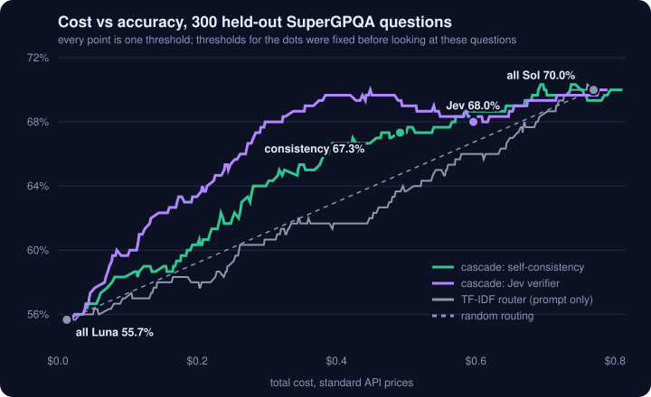
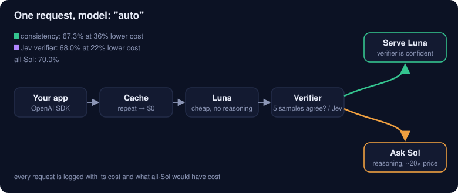

# llm-cost-autopilot

An OpenAI-compatible proxy that answers with a cheap model when that model can be trusted and escalates to an expensive reasoning model when it can't. Set `model: "auto"` and point your OpenAI client at it.

On 300 held-out graduate-level questions it keeps **67.3% accuracy at 36% lower cost** than sending everything to the expensive model (70.0%).



| Strategy | Accuracy | Cost (300 questions) | vs all-Sol |
|---|---|---|---|
| All `gpt-6-sol` (reasoning) | 70.0% | $0.769 | |
| **Cascade, self-consistency** (default) | **67.3%** | **$0.491** | **−36%** |
| Cascade, Jev verifier (optional) | 68.0% | $0.596 | −22% |
| TF-IDF router at the same spend | 63.7% | $0.491 | −36% |
| All `gpt-6-luna` (no reasoning) | 55.7% | $0.013 | −98% |

Both cascade thresholds were fixed before looking at the test questions: "all 5 samples agree" for self-consistency, and Youden's J on the 700 training questions (0.81) for Jev.

## How it works



1. **Gate.** Requests without a key, non-JSON bodies, `stream: true` and `n > 1` get a 4xx before anything is spent. Streaming is refused because the cheap answer has to be checked before the user sees it.
2. **Cache.** An exact repeat is served from SQLite for $0. The key is `sha256(Authorization)` plus `sha256(body)`, so callers never share a cache and neither API keys nor prompts are written to disk.
3. **Luna.** Every request first goes to `gpt-6-luna` with `reasoning_effort: "none"`, at about 5% of Sol's price.
4. **Verifier.** It decides whether to trust Luna:
   - `consistency` (default): ask for 5 samples in one call (`n=5`). If all 5 give the same answer, serve the first one.
   - `jev`: ask for one sample and let [TypeSafe's Jev](https://typesafe.ai/blog/introducing-system-one-models-and-jev) score it for correctness.
5. **Sol.** When the verifier isn't confident, the same request goes to `gpt-6-sol` with `reasoning_effort: "medium"`. Sampling parameters that reasoning mode rejects are dropped.
6. **Log.** Each request records its route, score, tokens, actual cost, and what all-Sol would have cost. The dashboard at `/` sums them.

The response is a normal chat completion. Three headers explain what happened: `x-autopilot-route` (`cheap`, `expensive`, `cache` or `passthrough`), `x-autopilot-score` and `x-autopilot-verifier`. Any model other than `"auto"` passes through untouched.

## What didn't work: reading the prompt

The first design was a router that looks at the prompt and predicts whether Luna will get it right. On the same 300 test questions, no prompt-only signal did much better than a coin flip. Signals that look at Luna's own answer did.

| Signal | Looks at | AUC (95% CI) |
|---|---|---|
| TF-IDF + logistic regression, trained on 700 labels | prompt | 0.52 (0.45–0.58) |
| SetFit, fine-tuned on the same labels* | prompt | 0.48 (0.40–0.54) |
| Jev: "answerable by recalling one fact?"* | prompt | 0.60 (0.54–0.67) |
| SuperGPQA's own expert difficulty label (not available on live traffic) | dataset | 0.58 |
| Luna's probability for its answer letter* | Luna's answer | 0.58 (0.52–0.64) |
| Luna states its own confidence; best of 4 prompts, chosen on the training questions* | Luna's answer | 0.60 (0.54–0.67) |
| Self-consistency of 5 samples | Luna's answer | 0.66 (0.60–0.72) |
| Jev: "is this answer correct?" (the proxy's exact request) | Luna's answer | 0.72 (0.66–0.78) |

\*Exploratory runs; their scripts are not part of this repo.

Asking Luna how sure it is was the weakest of the answer-based signals. It claims 90 or more on most answers, and the prompt that scored best on the training questions (AUC 0.66) fell back to 0.60 on the test set. Its behaviour is a better guide than what it says about itself.

Whether a question is hard *for this model* is not written in the question. The model's own behaviour carries it. This matches FrugalGPT ([Chen et al., 2023](https://arxiv.org/abs/2305.05176)) and AutoMix ([Madaan et al., 2023](https://arxiv.org/abs/2310.12963)).

## Run it

```bash
uv sync
echo "OPENAI_API_KEY=sk-..." > .env
uv run --env-file .env uvicorn autopilot.proxy:main_app --factory --port 8000
```

```python
from openai import OpenAI

client = OpenAI(base_url="http://localhost:8000/v1")  # your own key is passed through
raw = client.chat.completions.with_raw_response.create(
    model="auto", messages=[{"role": "user", "content": "What is the capital of France?"}]
)
print(raw.headers["x-autopilot-route"], raw.parse().choices[0].message.content)
```

The dashboard is at `http://localhost:8000/`.

| Variable | Default | Meaning |
|---|---|---|
| `AUTOPILOT_VERIFIER` | `consistency` | `consistency` or `jev` |
| `AUTOPILOT_THRESHOLD` | `1.0` / `0.81` | Minimum score to serve Luna's answer |
| `JEV_API_KEY` | | Needed only with `jev`. This key belongs to whoever runs the proxy. |
| `AUTOPILOT_DB` | `autopilot.db` | SQLite file for the cache and the log |

## Reproduce the numbers

```bash
uv run python -m offline.sample                           # 1000 SuperGPQA questions, 700 train / 300 test
uv run --env-file .env python -m offline.label pilot       # 20 questions: do the models differ? projected cost
uv run --env-file .env python -m offline.label submit      # Batch API, refuses above $5
uv run --env-file .env python -m offline.label collect
uv run --env-file .env python -m offline.consistency       # 5 Luna samples per question
uv run --env-file .env python -m offline.jev_verify        # optional, needs JEV_API_KEY
uv run python -m offline.train                             # TF-IDF baseline
uv run python -m offline.curve                             # data/curve.json
uv run python -m offline.figures                           # docs/*.svg
```

All model outputs are committed under `data/`, so `train`, `curve` and `figures` run without any API key. The whole study, including dead ends, cost under $1 of OpenAI usage and under $0.10 of Jev credit.

Along the way:

- **MMLU-Pro was saturated.** In the pilot both models scored 18/20 and missed the same two questions, even with Sol reasoning. The study moved to SuperGPQA, where they separate (11/20 vs 16/20).
- **`n=5` in one call equals 5 separate calls.** Same accuracy (55.0% vs 56.3%) and the same signal (AUC 0.68 vs 0.66), at a 36% lower Luna bill, because the prompt is billed once.
- **A lenient grader flatters the cheap model.** An earlier regex read `Answer: B, D, and E` as `B`. The strict grader counts 17 of Luna's 300 test answers and 4 of Sol's as unparseable, and therefore wrong.

## Limits

- **Confident mistakes pass.** Of the 131 test questions where Luna's served answer was wrong, all 5 samples agreed on that wrong answer in 56, so self-consistency let them through. Jev rated 32 of Luna's 133 wrong answers above its threshold. Neither signal catches a model that is consistently wrong.
- **The dataset has flaws.** 12 of the 300 test questions list the same option text twice, so one correct answer can be graded wrong.
- **Self-consistency needs comparable answers.** It compares the extracted letter, or the last line of the answer. Free-form prose rarely matches exactly, so most of it escalates and the cascade costs more than it saves. Jev doesn't have this limit, but it was only measured on multiple choice here.
- **One dataset, 300 test questions.** The confidence intervals are wide, and those of Jev and self-consistency overlap, so this data does not show that one is better.
- **The dashboard's savings are an estimate.** "What all-Sol would have cost" reuses Luna's token counts. Sol reasons, so it would really use more, which makes the displayed saving conservative.
- **Jev is proprietary and in early access.** It is optional. The default path needs only an OpenAI key.
- No streaming, no tool-call routing, and a single SQLite connection meant for one process.

## Layout

```
autopilot/   proxy.py (FastAPI app) · consistency.py · jev.py · store.py (SQLite) · prices.py · dashboard.html
offline/     sample · label (pilot + Batch API) · grade · consistency · jev_verify · train · curve · figures · site_export
data/        questions, model answers, samples, Jev scores, curve.json, site.json (the portfolio page's numbers; all committed)
tests/       92 tests; the upstream APIs are mocked
```

```bash
uv run ruff check . && uv run mypy autopilot offline tests && uv run pytest -q
```
